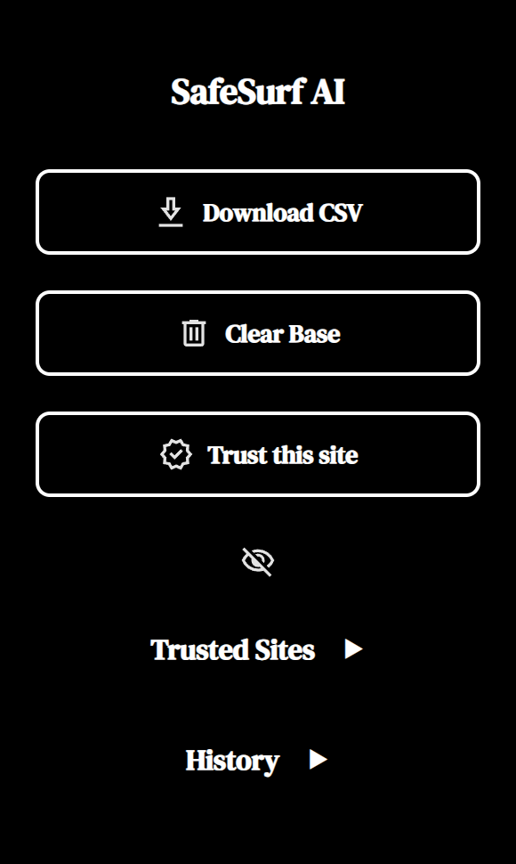

  

  <strong>A local phishing URL classifier, built for the browser.</strong> 
  Diploma research · Astana IT University · 2025

  <strong>English</strong> · <a href="README.ru.md">Русский</a> 
  <a href="#quick-start">Quick start</a> ·
  <a href="#how-it-works">Architecture</a> ·
  <a href="docs/MODEL.md">Model notes</a> ·
  <a href="docs/ROADMAP.md">Roadmap</a>

---

SafeSurf AI combines a **Chromium browser extension** with a **local Flask API** to classify visited URLs as `phishing` or `legitimate`. It turns URL text and structure into a shared feature vector, then evaluates it with a soft-voting ensemble of **Random Forest, XGBoost, and Logistic Regression**.

Developed for the diploma project *Detection of Phishing Attacks Using Machine Learning*, the repository contains the inference application, saved models, and browser interface.

> **Research prototype.** The current model has known false positives. Notifications appear after navigation and do not block a page. See [current limitations](#current-limitations) before relying on a verdict.

## At a glance

| Component | Implementation |
| --- | --- |
| Browser integration | JavaScript, HTML, CSS · Manifest V3 |
| Inference service | Python · Flask · `localhost:5001` |
| URL representation | 500 TF-IDF components + 21 numeric features |
| Classifier | Soft-voting ensemble · RF + XGBoost + LR |
| Local storage | Recent checks, flagged URLs, trusted domains |
| Research context | 95,910 labeled URLs reported in the thesis |

## Browser interface

  

Current popup rendered from the extension source with empty local storage. This interface preview is not an end-to-end extension test.

- **Automatic URL checks** on tab and navigation events, including SPA history changes.
- **Page notifications** with the verdict and selected URL indicators.
- **Recent history** with the last five API checks, model scores, and timestamps.
- **Trusted domains** that bypass the classifier, including their subdomains.
- **CSV export** of locally stored URLs flagged as phishing.
- **Compact controls** with an optional icons-only view.

Predictions run on your machine. The current classifier uses the URL string; it does not fetch the target page or send URLs to a cloud classification service.

## How it works

  

1. The extension reads a URL when a tab or navigation event occurs.
2. A locally trusted domain receives a `legitimate` verdict without a model request.
3. Other URLs are sent to `POST http://localhost:5001/predict`.
4. Python tokenizes the URL for TF-IDF and extracts 21 numeric features, such as length, hostname structure, keyword indicators, encoding, and character entropy.
5. A saved scaler transforms the numeric features. The combined **521-feature vector** is evaluated by the ensemble.
6. The API returns the class, phishing score, and raw features. The extension displays a notification and stores local results.

The notification's displayed “reasons” are heuristic checks on URL features. They are not model attribution or a SHAP explanation. Full details are in the [model notes](docs/MODEL.md).

## Quick start

### 1. Get the project

~~~bash
git clone https://github.com/nicr0s/SafeSurf-AI.git
cd SafeSurf-AI
~~~

### 2. Start the local API

Choose a Python environment or Docker. Run commands from the repository root so the application can find its model bundle.

<strong>Python environment</strong>

Create an environment with Python 3.11 or newer:

~~~bash
python -m venv .venv
~~~

Activate it on Windows PowerShell:

~~~powershell
./.venv/Scripts/Activate.ps1
~~~

Or on macOS / Linux:

~~~bash
source .venv/bin/activate
~~~

Install the dependencies and launch the API:

~~~bash
python -m pip install flask flask-cors joblib tldextract scipy "scikit-learn==1.6.1" "xgboost==2.1.4"
python app.py
~~~

The model was saved with scikit-learn `1.6.1` and XGBoost `2.1.4`. Inference was checked locally with those versions on Python 3.13; other Python/platform combinations have not been validated here.

<strong>Docker</strong>

Start Docker Desktop or a Docker Engine, then run:

~~~bash
docker build -t safesurf-ai .
docker run --rm -p 127.0.0.1:5001:5001 safesurf-ai
~~~

The supplied Dockerfile uses Python 3.11. This launch path has not yet been verified in the current review environment; dependency quoting and version pinning are tracked in the [roadmap](docs/ROADMAP.md).

Keep the API running while using the extension. Opening `/` in a browser returns `404`; the implemented endpoint is `POST /predict`.

### 3. Load the extension

1. Open `chrome://extensions` in Chrome, `edge://extensions` in Edge, or `brave://extensions` in Brave.
2. Enable **Developer mode**.
3. Select **Load unpacked** and choose the repository's `my-extension` directory.
4. Pin **SafeSurf AI** for access to history, trusted sites, and CSV export.
5. Open an HTTP or HTTPS page to trigger a check.

The extension targets Chromium browsers. This review did not perform a full browser installation and integration test.

### 4. Check the API

On macOS / Linux, or another shell with standard curl quoting:

~~~bash
curl http://localhost:5001/predict -H "Content-Type: application/json" -d '{"url":"https://du.astanait.edu.kz/"}'
~~~

On Windows PowerShell:

~~~powershell
$body = @{ url = "https://du.astanait.edu.kz/" } | ConvertTo-Json
Invoke-RestMethod -Uri "http://localhost:5001/predict" -Method Post -ContentType "application/json" -Body $body
~~~

An excerpt from the locally observed response follows. The actual response includes all 21 raw features:

~~~json
{
  "prediction": "legitimate",
  "probability": 0.429,
  "features": {
    "url_len": 27,
    "domain_len": 3,
    "entropy": 3.708
  }
}
~~~

`probability` is the ensemble's score for the **phishing class**, even when the predicted class is `legitimate`. It is not a validated guarantee of safety.

## Repository map

~~~text
SafeSurf-AI/
├── app.py                       # URL feature extraction and Flask /predict API
├── Dockerfile                   # Container definition
├── phishing_model_bundle.pkl    # Active ensemble, TF-IDF vectorizer, and scaler
├── xgb_model.pkl                # Separate legacy model; unused by the API
├── phishing_model.pkl           # Legacy metadata artifact; unused by the API
├── my-extension/
│   ├── manifest.json            # Manifest V3 and permissions
│   ├── background.js            # Navigation events and API requests
│   ├── content.js               # Page notifications and flagged URL storage
│   ├── popup.html               # Extension controls
│   ├── popup.css / popup.js     # Styling and control logic
│   ├── fonts/                  # Bundled interface fonts
│   └── *.svg / icon.png        # Interface assets
├── docs/
│   ├── assets/                 # README visuals
│   ├── MODEL.md                # Saved model and evaluation boundaries
│   └── ROADMAP.md              # Planned project improvements
├── CONTRIBUTING.md
└── README.ru.md                 # Russian documentation
~~~

## Research and evaluation

The thesis reports a dataset of **95,910 URLs**: **55,914 phishing** and **39,996 legitimate**, with an 80/20 train/test split. Reported sources include PhishTank, OpenPhish, Spamhaus DBL, URLhaus, and legitimate-domain rankings.

It compares Random Forest, XGBoost, and Logistic Regression and discusses feature distributions, learning curves, and browser integration. Different sections report accuracy figures around **95–97%** for different models or experiments.

**Those figures have not been reproduced for the bundled ensemble.** The dataset, collection scripts, training notebooks, and complete evaluation outputs are not included. This repository currently supports studying and running inference, rather than reproducing the entire research pipeline.

See [model notes](docs/MODEL.md) for verified artifact details and a small set of inference checks. Those checks are functional observations, not an accuracy benchmark.

## Current limitations

- **False positives:** local inference labeled `https://google.com` as phishing (`0.576`) and the original project URL `https://github.com/baidar-10/Diploma` as phishing (`0.631`).
- **Feature consistency:** domain parsing and other extraction details need to be reconciled with training preprocessing.
- **Browser event handling:** overlapping checks and delivery to the currently active tab can produce duplicate or misplaced notifications.
- **API errors:** missing or malformed input is not consistently validated; backend failures are currently logged rather than shown in the popup.
- **Protection scope:** URL-only classification does not inspect HTML, WHOIS, certificates, or live threat feeds, and does not block navigation.

The [roadmap](docs/ROADMAP.md) separates model validation, browser reliability, and packaging work.

## Authors and academic context

**Diploma:** *Detection of Phishing Attacks Using Machine Learning* 
**Institution:** Astana IT University · Department of Cybersecurity · Educational program 6B06301 
**Date:** June 2025

Authors, as listed in the thesis:

- Dayrabaev Alikhan
- Tleulin Sanzhar
- Zhubanyshev Baidar

**Supervisor:** Dana Oshakbay

This repository continues the group diploma project originally stored in [baidar-10/Diploma](https://github.com/baidar-10/Diploma), preserving its Git history and author credits.

For changes, experiments, and issue reports, see [contributing](CONTRIBUTING.md). An open-source license has not yet been selected.
